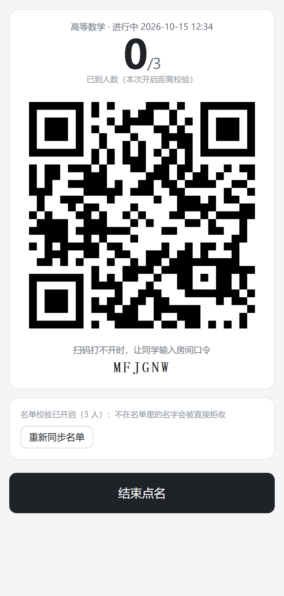
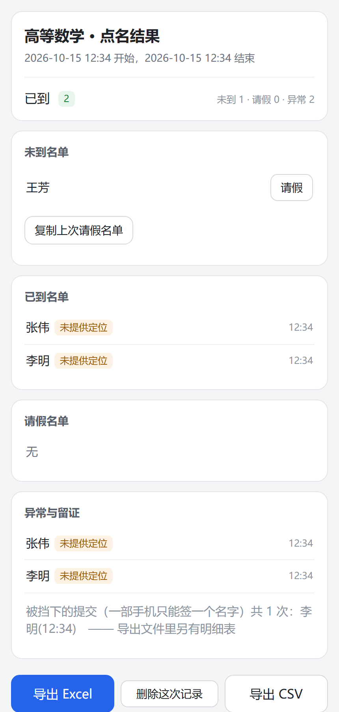
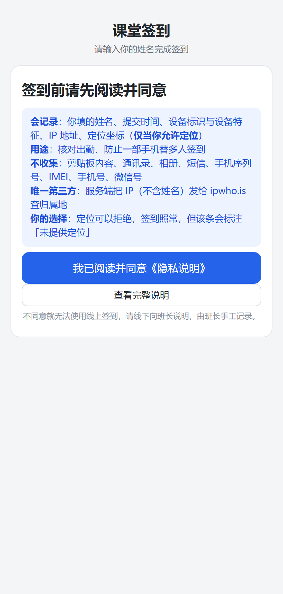
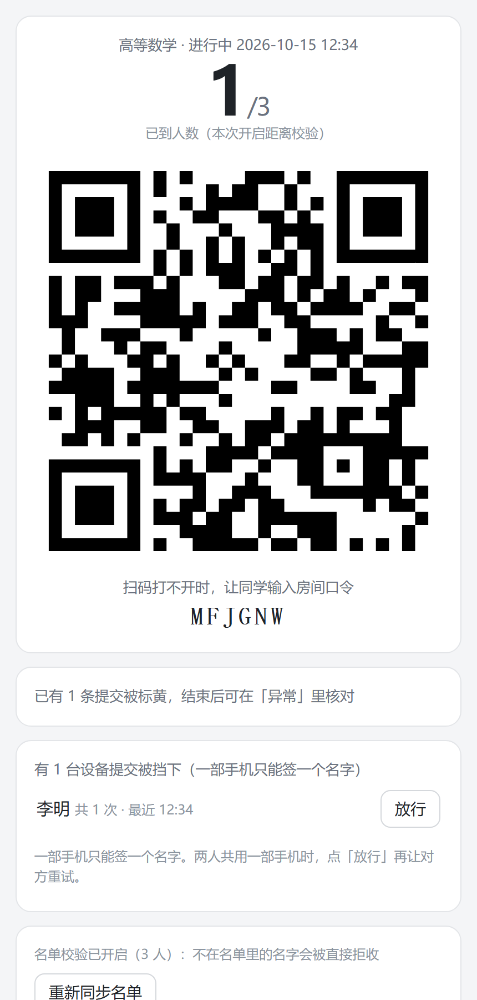

<div align="center">

# 课堂点名 · Class Check-in

**班长安卓 App 亮二维码 → 同学扫码打一个名字 → 云端实时算「已到 x/60」→ 结束点名出四类名单，一键导出 Excel**

[](LICENSE)
[](app/package.json)
[](app/test)
[](#)

</div>

---

## 截图

| 点名中（二维码 + 大计数） | 结果页（四类名单） |
|---|---|
|  |  |

| 同学端：先同意再签到 | 被挡记录按设备归并 |
|---|---|
|  |  |

完整《隐私说明》页：[`docs/screenshots/04-privacy.png`](docs/screenshots/04-privacy.png)

---

## 为什么做这个

大学班级点名是个重复、尴尬又容易造假的活。这个项目的取舍是：**把复杂度全部压在班长端和服务端，同学端只要"扫一下、打名字"**——不装 App、不注册、不绑手机、不授权微信。

## 特性

**同学端（网页，扫码即用）**
- 只接受中文姓名（覆盖全部汉字，含扩展区生僻字，2–15 字），其他字符打不进去
- **首次使用先阅读并同意《隐私说明》才能签到**；条款更新会要求重新确认
- 提交后实时反馈「签到成功，你是第 N 位」

**班长端（安卓 APK，侧载）**
- **房间号 + PIN**：没有账号体系（见下面「关于 PIN 的实话」）
- 导入花名册 Excel/CSV，全屏二维码 + 大计数 + 每来一人轻震动
- 结束点名 → 已到 / 未到 / 请假 / 异常四类名单，一键导出 Excel/CSV（含留证列 + 一张「被挡记录」表）
- 历史记录，可**删除单条或清空全部**；长期请假可一键复制上次的请假名单

**反作弊（两层设计，边界写在明面上）**

| 层 | 做什么 |
|---|---|
| **硬拦（真的不让提交）** | 姓名必须在本班名单（只上传**姓名哈希 + 随机盐**，服务端不存明文）；**同一台设备一节课只能签一个名字**（清缓存/换隐身模式换身份也会被认出，身份存在 cookie + localStorage + sessionStorage 三处）；超长冷却；点名关闭后一律拒收 |
| **标黄 + 留证（不拦，供事后核对）** | 未提供定位、距离偏离、与他人坐标完全相同、定位精度异常、设备特征与他人完全相同、IP 与定位不符、疑似机房/代理出口、同名重复；**每次被挡的提交也留证** |

**明确做不到的（浏览器层面没有接口，不是没做）**：拿不到手机序列号、拿不到「是否模拟定位」标志位、不能强制 WiFi 定位、无法检测 root、「换一台手机来替签」只能靠随堂抬头抽查 + 留证追责。

---

## 架构

```
班长端 APK（WebView 外壳，原生桥只做震动与保存文件）
  └─ 加载云端页面 → 建班 / 导花名册 / 发起点名 / 亮二维码 / 看名单 / 导出
                        │  HTTPS + JSON（口令走 X-Pin-Key 请求头）
同学端网页（同一个页面的另一种模式：?s=场次码）
  └─ 填姓名 → POST /api/checkin
                        │
服务端（Node，零依赖，单端口）
  ├─ 静态托管（页面 + 自带的二维码/表格库，不引用外部 CDN）
  ├─ 判定全部在服务端：名单哈希校验、设备限制、冷却、坐标/IP/指纹标黄
  └─ 存储落盘 JSON（默认 ~/.classcheckin，原子写 + 防抖）
```

### 关键取舍

| 决定 | 为什么 |
|---|---|
| **花名册不上传，只上传姓名哈希** | 服务端只需要判断"在不在名单"，不需要知道是谁。比对出勤在班长手机本地完成 |
| **一机一名硬拦，但"放行"= 班长手动豁免一次** | 挡住"一部手机替全宿舍签到"；同时给"两人共用一部手机"留一条人工兜底 |
| **属性指纹只标黄、不硬拦** | 同款同配置手机的属性完全相同，硬拦会误杀无辜同学（实测过） |
| **坐标抄袭判定要求精度 ≤30m 且同坐标 ≤8 人** | 全班连同一个校园 WiFi 时会拿到同一组粗略坐标，不这样收窄就会全班误报 |
| **IP 只在"定位在国内、出口在境外"时标** | 运营商出口城市与教室城市不同很常见，不能当作弊 |
| **零依赖后端** | 只用 Node 内置模块，`npm start` 就能跑，部署到任何单端口环境 |
| **二维码纯前端生成** | 不引入外部图片服务，也不把二维码内容传到任何第三方 |

## 快速开始

### 1. 部署你自己的云端

> ⚠️ **必须 HTTPS**：浏览器只在安全上下文（HTTPS / localhost）提供地理定位与 `crypto.subtle`。
> 用 HTTP 部署会导致定位全部失效、PIN/名单哈希退化，且**没有任何报错提示**。

```bash
cd app
npm start            # 监听 $PORT（默认 3000）
npm test             # 单元测试（11 条）
```

### 2. 打包班长端 APK

```bash
cd android
# gradle.properties 里把 siteHost 改成你的部署域名（不含 https://）
# 仍是占位符 your-domain.example.com 时构建会直接失败并提示
gradle assembleRelease
```

签名密钥自己生成（`keytool -genkeypair ...`，详见 `docs/使用说明.md`）；
`keystore.properties` 不存在时自动回退 debug 签名（能装，但不能覆盖升级到正式包）。

### 3. 配置项

| 位置 | 项 | 说明 |
|---|---|---|
| `app/config.js` | `siteOrigin` | 留空 = 自动用当前页面地址（推荐） |
| `app/config.js` | `operator` | 《隐私说明》里"数据管理者"的称呼 |
| `android/gradle.properties` | `siteHost` | APK 连接的域名（编译期注入） |
| 环境变量 | `PORT` / `CHECKIN_DATA_DIR` | 服务端口 / 数据目录 |
| 环境变量 | `CHECKIN_KEEP_SESSIONS` | 每房间保留场次数（默认 60，超出自动淘汰） |
| 环境变量 | `CHECKIN_MAX_ROOMS` | 房间数上限（默认 200） |
| 环境变量 | `CHECKIN_COOLDOWN_MS` | 同设备冷却（默认 10,000,000 秒，按场次判定） |
| 环境变量 | `CHECKIN_IP_LOOKUP=0` | 全局关闭 IP 归属地查询 |
| 环境变量 | `CHECKIN_XFF=off` | 不信任 `X-Forwarded-For`（直连部署时用） |

---

## 关于 PIN 的实话（别当成账号体系）

**PIN 是两道东西的合体**：① 班长手机上的本地锁（防止同学随手点开 App）；② 与服务端约定的房间口令。

它**不是**身份认证：知道口令的人调接口就能读写该房间数据。所以——
- 口令**不能外传**（和二维码一样是入场券）；
- 服务端所有房间级接口都以口令为唯一凭据，没有第二个因素；
- 真要更强的隔离，需要账号体系或设备绑定，那是另一个项目。

## 关于 IP 标黄的实话

`X-Forwarded-For` 可以被客户端伪造，所以「IP 与定位不符 / 疑似代理」只是**参考证据**，不是铁证；
它存在的意义是提高作弊成本 + 事后留证。直连部署可设 `CHECKIN_XFF=off` 强制用 socket 地址。

## 隐私

- 同学**首次签到前必须阅读并同意**《隐私说明》（应用内 `/privacy`），班长端建班也要勾选
- **不收集**：剪贴板、通讯录、相册、短信、通话记录、手机序列号、IMEI、手机号、微信号；页面无任何第三方广告或统计脚本
- 姓名以**不可逆哈希**形式参与名单校验（服务端不保存明文）
- 唯一第三方 `ipwho.is`（只发 IP，用于判断机房/代理出口；班长端可关，或设 `CHECKIN_IP_LOOKUP=0`）
- 记录**只保留最近 60 场**，班长可删除单条或清空全部

## 已知限制

- **多数托管平台的域名会拦截微信内置浏览器**（返回「当前应用不支持在微信内打开」），这是平台策略，不是代码问题。
  实测 iPhone Safari / 安卓 Chrome / 小米 / 华为 / QQ 浏览器全部正常 → 让同学**用手机相机扫码**，或把链接存成浏览器书签后每节课输 6 位口令。
- 微信「一键授权登录」在网页端做不到（需要微信开放平台企业资质）→ 本项目没有账号体系，用房间号 + PIN。

## 测试

```bash
cd app && npm test     # node --test，11 条：距离/坐标/姓名规则/名单哈希/淘汰/限流/口令优先级/场次码
```

CI（`.github/workflows/test.yml`）：跑单测 + 启动冒烟。

## 目录结构

```
app/                 同学端 + 班长端网页 + Node 服务端
  ├─ index.html      两种模式：?s=场次码 → 同学签到；否则 → 班长端
  ├─ app.js          全部前端逻辑（设备指纹、名单哈希、导出）
  ├─ server.js       零依赖服务端（静态托管 + 点名 API + 全部判定）
  ├─ privacy.html / privacy.js   《隐私说明》
  └─ libs/           自带的二维码 / 表格库（见 THIRD_PARTY_NOTICES.md）
android/             班长端 APK 工程（Java + WebView 外壳 + 原生桥）
docs/                使用说明、花名册导入模板、截图
app/test/            单元测试
```

## 许可

MIT（见 `LICENSE`）。内置的两个前端库许可见 [`THIRD_PARTY_NOTICES.md`](THIRD_PARTY_NOTICES.md)。
